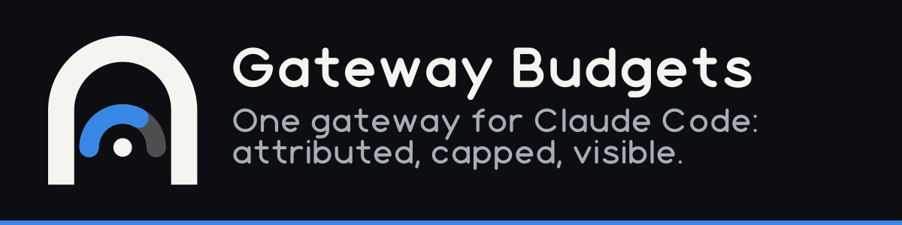
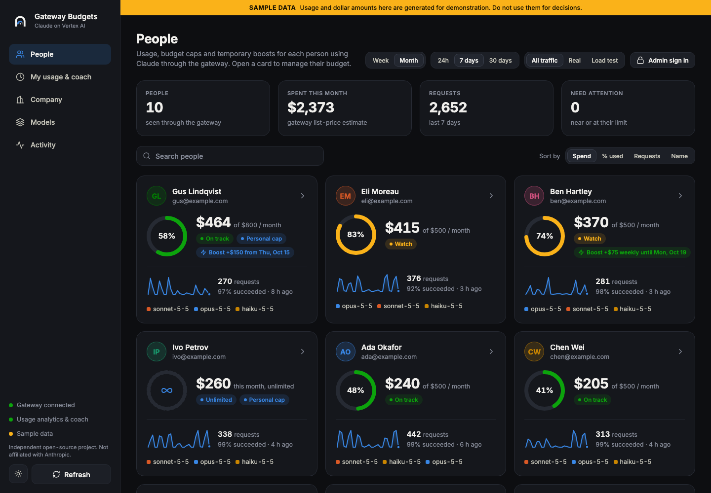
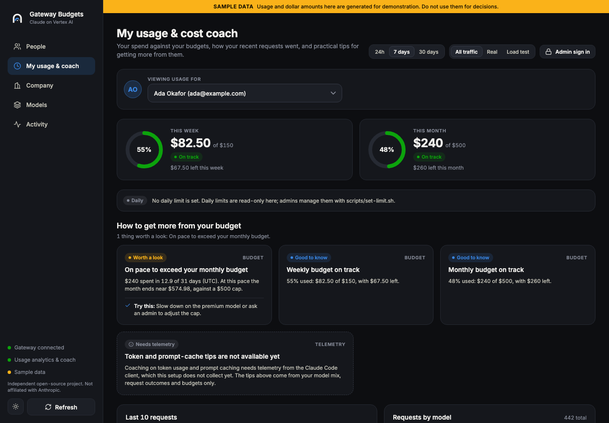
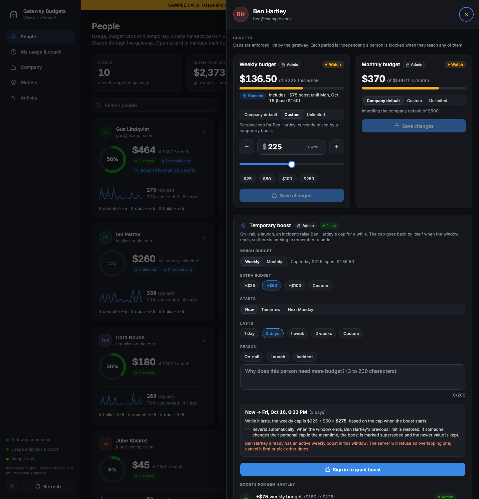
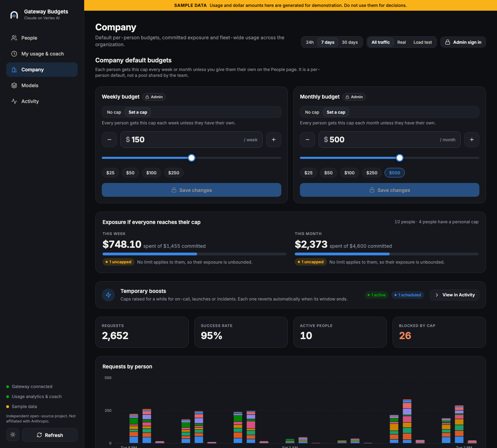
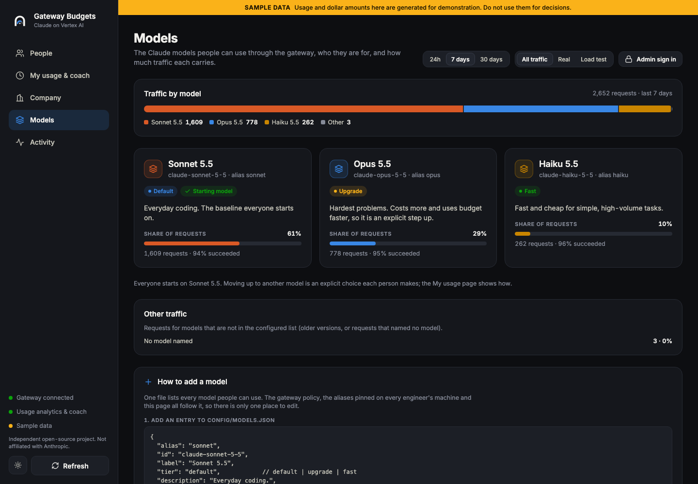
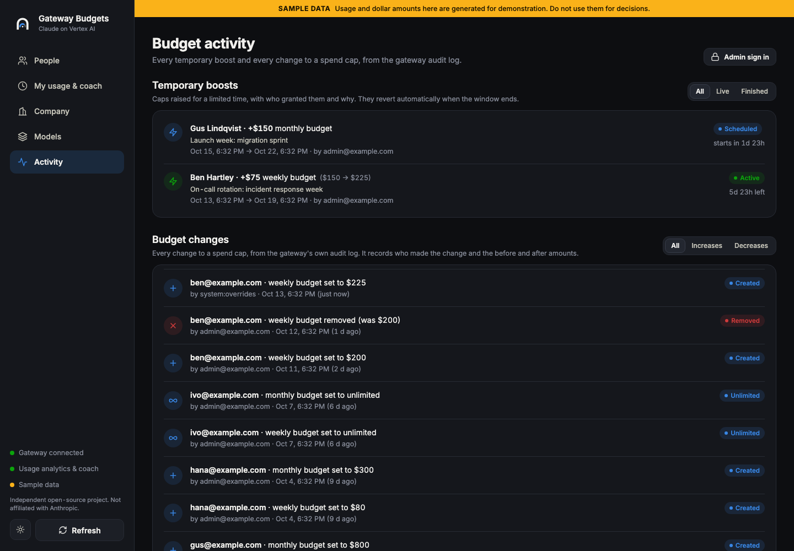
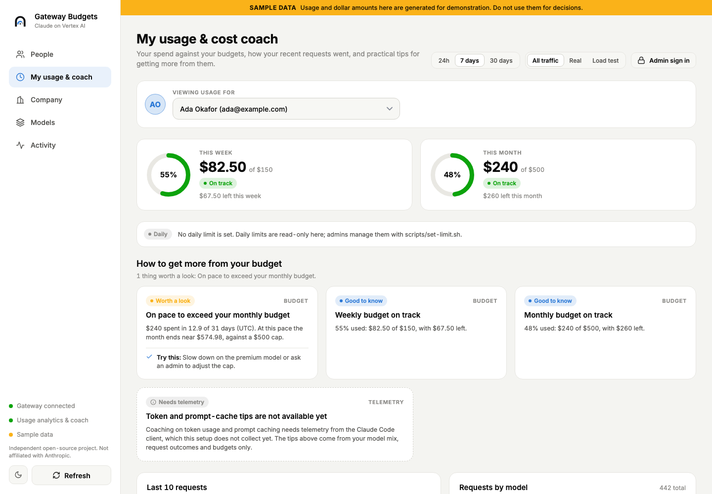
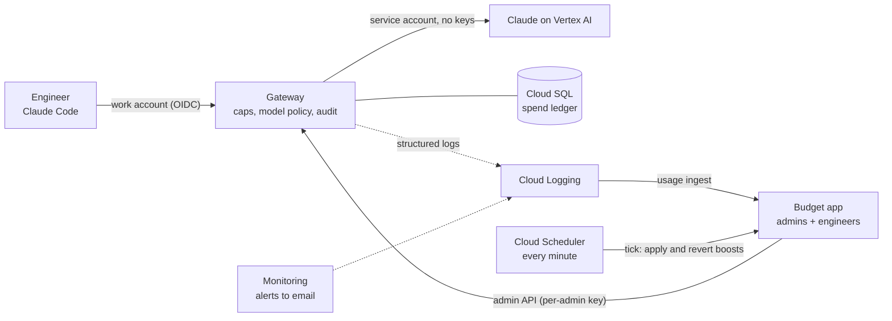

<p align="center">
  
</p>

<p align="center">
  <a href="LICENSE"></a>
  <a href="https://github.com/matthewmc1/claude-gateway/actions/workflows/ci.yml"></a>
  
  
</p>

# Gateway Budgets

**Give your engineers Claude Code through one company gateway, with every request attributed, every person capped, and everything visible.**

Engineers sign in with their work account. Admins see who is using what, set weekly and monthly budgets per person, and grant
temporary on-call boosts that undo themselves. Platform and finance get an audit trail and alerts. Everything runs in *your*
Google Cloud project; nothing leaves it.

> Independent open-source project. Not affiliated with, endorsed by, or sponsored by Anthropic. It builds on Anthropic's own
> [Claude apps gateway](https://code.claude.com/docs/en/claude-apps-gateway), which ships inside the `claude` binary, and adds the
> budget app, Terraform, installer and monitoring around it.

<p align="center">
  
  <br><sub>People: everyone's budget at a glance. Screenshots use built-in sample data (<code>scripts/demo.sh</code>).</sub>
</p>

## Why use it

### For engineers

| You get | How |
|---|---|
| **No keys on your laptop** | Sign in once with your work account (OIDC). No API keys, no cloud credentials. |
| **One command to set up** | `claude-gateway-setup.sh install`. Your admin has already baked in the gateway address and sensible defaults. |
| **A good default, an honest step up** | Sonnet 5.5 at medium effort out of the box. Moving up to Opus 5.5 is one explicit command, and the app tells you it spends budget faster. |
| **See your own spend** | *My usage*: weekly and monthly budget rings, what is left, and your pace. |
| **Know why a request failed** | Your last 10 requests with the real cause (quota, permission, budget cap), not a vague error. |
| **Practical tips from real data** | Model mix, error rate and budget pace turned into plain advice with a copyable command. |

### For admins

| You get | How |
|---|---|
| **Everyone's usage in one place** | People, models, outcomes, latency. Data is visible without a login; changes need an admin. |
| **Budgets that bite** | Weekly and monthly caps per person, company defaults, "unlimited" exceptions. Enforced by the gateway on every request. |
| **On-call boosts that undo themselves** | Give someone +$75 for the incident week with a reason. The cap goes back on its own, and if someone edits it meanwhile, your boost steps aside instead of overwriting. |
| **Accountability** | Each admin has their own account and gateway key, so the audit trail says *who* changed *which* cap, not "an admin". |
| **Alerts, not surprises** | Email alerts for provider error bursts, spend-cap blocks, sign-in problems, gateway or database trouble. |
| **Add models without a redeploy dance** | One file, `config/models.json`. The gateway policy, every engineer's model aliases and the app all follow. |

### For platform, security and finance

* **Private by default.** Cloud Run services require Google IAM; no public endpoints; the database has no public IP.
* **Only your people sign in.** OIDC against your Google (or Okta/Entra) accounts, restricted to your email domains.
* **Everything is code.** Terraform provisions it (one wizard, one file of settings); the engineer installer is a script you can read.
* **You can audit it.** Zero runtime dependencies in the backend; the whole thing is MIT-licensed and small enough to read in an afternoon.

## See it

<table>
<tr>
<td width="50%"><br><b>My usage &amp; coach.</b> Budget rings, tips from real signals, last 10 requests.</td>
<td width="50%"><br><b>Temporary boost.</b> +$75 for the incident week, reverting automatically, with a reason on record.</td>
</tr>
<tr>
<td width="50%"><br><b>Company.</b> Per-person defaults, exposure if everyone hit their cap, live boosts.</td>
<td width="50%"><br><b>Models.</b> The catalog people can use, who uses it, and how to add one.</td>
</tr>
<tr>
<td width="50%"><br><b>Activity.</b> Every cap change and boost, by whom, when.</td>
<td width="50%"><br><b>Light and dark</b>, desktop and phone width.</td>
</tr>
</table>

## How it works



## Quick start

**1. Try it in a minute: no cloud, no gateway, no credentials.**

```bash
git clone https://github.com/matthewmc1/claude-gateway && cd claude-gateway
./scripts/demo.sh           # http://localhost:8792  ·  admin sign-in: admin@example.com / demo-admin
```

**2. Deploy to your Google Cloud project.**

```bash
cd terraform
./setup.sh --create-state-bucket   # wizard: project, admins, email domain, profile (trial|production), Google sign-in, private state bucket
terraform init
terraform apply -target=google_artifact_registry_repository.images -target=google_project_service.apis
../deploy/build-push.sh            # verifies and builds the gateway and app images, prints the app image tag
terraform apply -var app_image_tag=<that tag>   # everything else (the database takes 10-15 minutes)
```

Terraform cannot create Google's sign-in (OAuth) client for you; `setup.sh` and `terraform output oidc_setup_steps`
give the exact console steps and redirect URI. Details, costs and teardown: [docs/DEPLOY.md](docs/DEPLOY.md).

**3. Roll out to engineers.**

```bash
scripts/package-client.sh --gateway-url https://your-gateway   # one self-contained installer, gateway address baked in
# engineers then run, with no arguments:
./claude-gateway-setup.sh install
claude        # /login -> "Cloud gateway" -> sign in with the work account
```

## The flows, end to end

| Flow | What happens | Where |
|---|---|---|
| **Admin setup** | Define admins and defaults once; Terraform creates private services, a database, secrets, alerts, a scheduler | [`terraform/`](terraform/) |
| **Engineer onboarding** | One installer sets the gateway, locks sign-in to it, blocks direct Anthropic/Vertex/API-key use, sets Sonnet 5.5 and medium effort | [`client/`](client/) |
| **Daily use** | Requests flow through the gateway; each is attributed to a person, checked against their caps, logged | gateway |
| **Tracking** | Usage is rolled up hourly from the gateway's own logs: per person, model and outcome, latency | `api/lib/usage` |
| **Budget changes** | Admin signs in only when changing something; every change is attributed to them in the gateway audit trail | People, Company |
| **On-call boost** | Reason + window + extra amount; applied automatically at the start, restored at the end, steps aside if edited by hand | `api/lib/overrides.mjs` |
| **Monitoring** | Log-based metrics and alert policies email the admins; a dashboard covers rate, errors, latency, database | `terraform/monitoring.tf` |
| **Improving over time** | Coach tips from model mix, errors and pace today; token and prompt-cache coaching once client telemetry is collected (not yet) | My usage |
| **Extending** | Edit `config/models.json` to add a model; add a Vertex region or project as another upstream | [docs/DEPLOY.md](docs/DEPLOY.md) |

## By the numbers

All measured from this repository, not estimated.

| | |
|---|---|
| Automated checks that run without Docker | **1,233** (228 backend · 75 UI · 527 installer · 306 Terraform · 97 deploy) |
| End-to-end tests against the real gateway binary | **85** (need Docker for a throwaway database: `scripts/e2e.sh`) |
| Backend runtime dependencies | **0** (Node built-ins only) |
| Product code | 2,828 lines backend · 2,993 UI · 1,254 installer · 2,744 Terraform · 393 deploy |
| Time from clone to a running demo | **under a minute** after the first web build (server cold start 0.17 s) |
| Demo data | 10 people, 11,550 requests over 30 days, answered in about 5 ms per page |
| Engineer setup | **1 command**, no arguments, once the admin has packaged the installer |
| Infrastructure | private Cloud Run x2, Cloud SQL, 8 secrets, 20 alert policies, 17 log metrics, 1 dashboard |
| Money saved | not claimed: this is a visibility and control tool, and your savings depend on your usage |

## Security model in brief

* The app **only listens on loopback** locally and refuses to start otherwise. On Cloud Run it is private behind Google IAM.
* Data is **readable without a login by default** (that is the point: visibility). Set `APP_VIEW_ACCESS=admin` (Terraform: `view_access`) to require sign-in for reads too.
* **Every write needs an admin**, uses that admin's own gateway key, and is rate-limited and logged.
* Admin keys and passwords are server-side only and never sent to a browser. Terraform state holds them: use a private remote backend.

Read [SECURITY.md](SECURITY.md) for the full threat model and how to report a problem.

## Honest limits

* **Spend is the gateway's list-price estimate**, a guardrail, not an invoice. Reconcile against your cloud bill.
* **No token or prompt-cache analytics yet.** The gateway's own events carry no token counts; that needs client telemetry, which is not collected. The coach says so instead of guessing.
* **The current Terraform has been validated and planned offline (225 checks) but not applied end to end** in an automated test: Cloud Run starting with the new sizing and probes, Cloud Scheduler's token being accepted, and the alert filters firing on real traffic are verified only by reading and by tests against the real gateway binary's log shapes. Do a `trial`-profile apply first.
* **No real Claude reply has been observed through the Vertex path in this repository's tests**: the end-to-end suite uses a fake Vertex upstream for replies. Check Model Garden access and quota (`global_online_prediction_requests_per_base_model`) before rollout.
* **Real sign-in end to end** (Claude Code through your identity provider) depends on your IdP and has not been exercised by this repository's automated tests.
* **The Windows installer is untested** (no PowerShell in the build environment). macOS and Linux are tested.
* **Weekly budget periods** follow the gateway's own boundaries, which are not documented; the app shows what the gateway reports.

## Repository map

| Path | What |
|---|---|
| [`terraform/`](terraform/) | Google Cloud provisioning, setup wizard, monitoring, tests |
| [`client/`](client/) | Engineer installer (bash; PowerShell untested), packager, tests |
| [`api/`](api/) | Backend: gateway client, usage, overrides, coach, routes (zero dependencies) |
| [`app/`](app/) | React Native Web UI (Expo) |
| [`deploy/`](deploy/) | Image build and push, local authenticating proxy |
| [`config/`](config/) | `models.json` (the model catalog) and local-stack configs |
| [`docs/`](docs/) | [Architecture and contracts](docs/ARCHITECTURE.md), [deploy guide](docs/DEPLOY.md), [local stack](docs/LOCAL-DEV.md) |
| [`assets/brand/`](assets/brand/) | Logo and icons |

## Contributing

Issues and pull requests are welcome: see [CONTRIBUTING.md](CONTRIBUTING.md). Run the suites listed in [CLAUDE.md](CLAUDE.md#tests) before you open a PR.
Licensed under the [MIT License](LICENSE).
